# 1. Introduction and Acknowledgments

This tutorial provides an introduction to processing ALS (Airborne Laser Scanning) point cloud data using `lidR` and spatial analysis packages in R. 
Our team (biotope diversity) is exploring the opportunities and challenges presented by this type of data and its associated models so that we are prepared for the new research questions that will undoubtedly arise once the new aerial LiDAR campaign (which is currently being carried out) is complete. 
The data and products are planned to be ready in 2028: [digitaal hoogtemodel Vlaanderen](https://www.vlaanderen.be/digitaal-vlaanderen/nieuws/dit-jaar-start-de-vernieuwing-van-het-digitaal-hoogtemodel).

The workflow integrates:

1. **A custom workflow script** based on regional LiDAR data (e.g., Open
   Data Vlaanderen) pre-classified with deep learning models (3D SegFormer).
2. **Individual Tree Segmentation (ITS)** techniques adapted from the
   [lidRtutorial by Tristan Goodbody](https://tgoodbody.github.io/lidRtutorial/06_its.html)
   ([GitHub repository](https://github.com/tgoodbody/lidRtutorial/blob/master/R/06_its.R)).
3. **Advanced tree metrics and point cloud processing** concepts inspired
   by Liam Irwin’s [CompTreeR](https://liamirwin.github.io/CompTreeR/).

The code was compiled and documented with the support of Gemini.

------------------------------------------------------------------------

# 2. Setup & Data Preparation

## 2.1 Package Installation & Environment

First, ensure all required R packages are installed.

``` r
# Core LiDAR processing package
if (!requireNamespace("lidR", quietly = TRUE)) install.packages("lidR")

# Optional ground classification algorithm support
if (!requireNamespace("RCSF", quietly = TRUE)) install.packages("RCSF")

# Spatial handling and raster processing
if (!requireNamespace("sf", quietly = TRUE)) install.packages("sf")
if (!requireNamespace("terra", quietly = TRUE)) install.packages("terra")
if (!requireNamespace("stars", quietly = TRUE)) install.packages("stars")
if (!requireNamespace("alphashape3d", quietly = TRUE)) install.packages("alphashape3d")
if (!requireNamespace("knitr", quietly = TRUE)) install.packages("knitr")

# Load libraries
library(lidR)
library(sf)
library(terra)
library(stars)
library(alphashape3d)
library(knitr)
```

## 2.2 External Data Workflow (QGIS Pre-processing)
The output of the following steps can be downloaded from the
[GitHub page for this tutorial](https://github.com/inbo/tutorials/tree/main/content/tutorials/r_lidR).
1.  **Download Data**: Download `.laz` tiles matching your area of
    interest (e.g., via [OpenLidar
    Vlaanderen](https://remotesensing.vlaanderen.be/apps/openlidar/#collapseDataDownload)).


2.  **Merge Tiles**: Merge overlapping `.laz` files using the QGIS
    **Merge** tool.

3.  **AI Classification**: Pre-classify ground, vegetation, buildings,
    poles, wires, and transmission towers (not necessary in natural
    environments, but useful in complex urban areas) using the
    **SegFormer 3D Airborne model (30 cm)** via the LiDAR AI Classifier
    plugin in QGIS.


------------------------------------------------------------------------

# 3. Data Loading & Quality Control

## 3.1 Loading Classified LAS Data

``` r
# Load the pre-classified LAS/LAZ file
las_path <- "./classified_3dsegformer.laz"
classified <- readLAS(las_path)

# Verify CRS and structure
print(classified)
```

## 3.2 Data Inspection (`las_check`)

It is crucial to inspect point cloud validity (e.g., duplicated points,
scan angle missing values, normalization status).

``` r
# Check data integrity and attributes
# Duplicate points occur where LAZ tiles overlap. You can remove them before
# analysis, although most package functions detect and remove them
# automatically. For statistical analysis and metrics, it is better to remove
# duplicates. Degenerate ground points can result from sensor errors or
# moving objects during scanning; for example, wind can move tree crowns and
# produce different Z values at the same locations.
las_check(classified)
```

## 3.3 Initial 3D Visualization

Quickly inspect point cloud attributes in 3D using `lidR::plot()`.

``` r
# Visualization colored by elevation
plot(classified, color = "Z")

# Color by intensity
#plot(classified, color = "Intensity")

# Color by AI classification values
plot(classified, color = "Classification")

# Color by RGB (if available in point cloud attributes)
plot(classified, color = "RGB")
```

------------------------------------------------------------------------

# 4. Height Normalization & Transect Analysis

Point cloud elevation (*Z*) reflects absolute elevation above sea level.
Height normalization converts *Z* to height above ground surface.

## 4.1 Ground Normalization

``` r
# Height normalization using a Triangular Irregular Network (TIN) ground model
norm <- normalize_height(classified, tin())
```

## 4.2 Cross-Section Visualizations (Transects)

Extracting cross-sections allows visual validation of height
normalization and canopy structure.

``` r
# Define transect endpoints (Coordinates in local projection, e.g., Belge 1972 / Lambert 72)
X1 <- 149800; Y1 <- 180514
X2 <- 150000; Y2 <- 180514

# Slice 2-meter wide transects for raw and normalized point clouds
slice <- clip_transect(classified, p1 = c(X1, Y1), p2 = c(X2, Y2), width = 2)
slice_norm <- clip_transect(norm, p1 = c(X1, Y1), p2 = c(X2, Y2), width = 2) 

# Compare raw vs. normalized profile plots
par(mfrow = c(2, 1))
plot(slice$X, slice$Z, col = slice$Z, pch = 19, main = "Raw Elevation Profile", xlab = "Distance", ylab = "Elevation (m)")
plot(slice_norm$X, slice_norm$Z, col = slice_norm$Z, pch = 19, main = "Normalized Height Profile", xlab = "Distance", ylab = "Height above ground (m)")
```

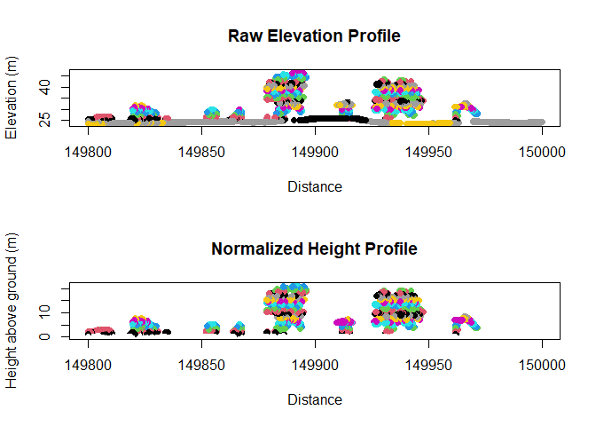

``` r
par(mfrow = c(1, 1))
```

------------------------------------------------------------------------

# 5. Individual Tree Segmentation (ITS)

This section combines canopy model generation and tree detection
techniques adapted from [Goodbody
(lidRtutorial)](https://tgoodbody.github.io/lidRtutorial/06_its.html)
and [Irwin (CompTreeR)](https://liamirwin.github.io/CompTreeR/).

## 5.1 Canopy Height Model (CHM) & Tree Top Detection

``` r
# Filter normalized point cloud to high vegetation (ASPRS class 5)
high_veg <- filter_poi(norm, Classification == 5)

# Generate a 0.5m Canopy Height Model using Pit-free or Point-to-Raster algorithms
chm <- rasterize_canopy(high_veg, res = 0.5, algorithm = p2r(subcircle = 0.15))

# Locate individual tree tops using a Local Maximum Filter (LMF)
# Variable window size (ws) can also be used: e.g., function(z) { z * 0.1 + 1 }
# This algorithm works on both normalized point clouds and DSMs, although the
# results may differ slightly.
ttops <- locate_trees(high_veg, lmf(ws = 5))

# Plot CHM with detected tree tops
plot(chm, main = "Canopy Height Model with Detected Treetops")
plot(sf::st_geometry(ttops), add = TRUE, col = "red", pch = 3, cex = 0.8)
```

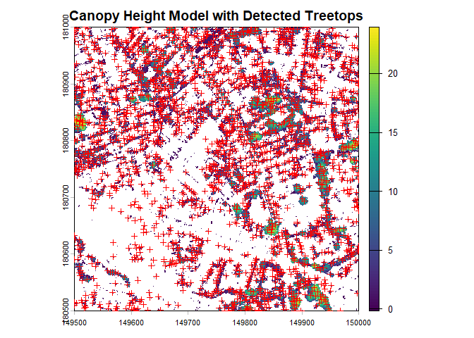

If you do the same with the normalized LAZ file without filtering for
high vegetation, the `locate_trees()` algorithm may mistake buildings
and other urban structures for trees.

``` r
# Generate a 0.5m Canopy Height Model using Pit-free or Point-to-Raster algorithms
chm2 <- rasterize_canopy(norm, res = 0.5, algorithm = p2r(subcircle = 0.15))

# Locate individual tree tops using a Local Maximum Filter (LMF)
# Variable window size (ws) can also be used: e.g., function(z) { z * 0.1 + 1 }
ttops2 <- locate_trees(norm, lmf(ws = 5))

# Plot CHM with detected tree tops
plot(chm2, main = "Canopy Height Model with Detected Treetops")
plot(sf::st_geometry(ttops2), add = TRUE, col = "red", pch = 3, cex = 0.8)
```


``` r
nrow(ttops)
nrow(ttops2)
```

## 5.2 Tree Segmentation Algorithms

`lidR` provides multiple segmentation algorithms: `li2012()`,
`dalponte2016()`, `silva2016()`, and `watershed()`. You could do tree
segmentation on point clouds, but when working with large LAZ files, it
is faster to convert the point cloud to a CHM and perform the
segmentation on the CHM.

``` r
# Point-to-point tree segmentation using Li et al. (2012)
segmented_las <- segment_trees(high_veg, li2012()) # +/- 3 min. computation time

# Plot the segmented point cloud where colors represent individual tree IDs
plot(segmented_las, color = "treeID")

ttops_seg <- tree_metrics(segmented_las, func = .stdmetrics) %>% st_as_sf()
kable(summary(ttops_seg[,c( "zmax", "zmean","zsd","zq95","area")]%>% st_drop_geometry()))


hist(ttops_seg$zmax,plot = T, main = "Height Distribution (m)",xlab =   "Height (m)",ylab = "Frequency")
```

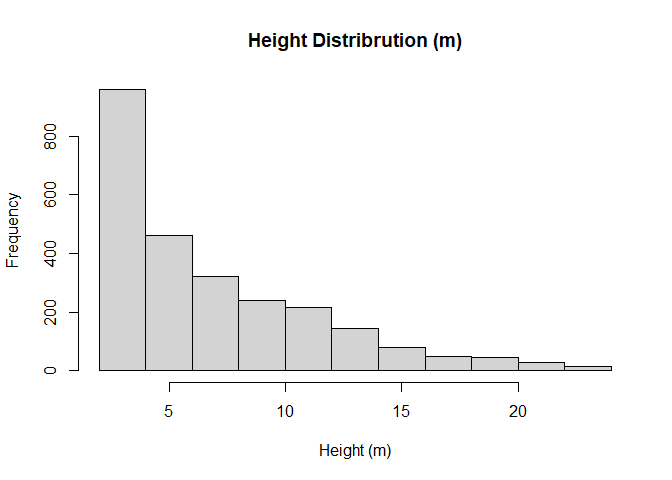

## 5.3 Transect Inspection of Tree Clusters

``` r
# Clip transect of segmented trees
slice_tree <- clip_transect(segmented_las, p1 = c(X1, Y1), p2 = c(X2, Y2), width = 2)

# Plot profile colored by segmented tree IDs
plot(slice_tree$X, slice_tree$Z, col = slice_tree$treeID, pch = 19, 
     xlab = "Distance", ylab = "Height", main = "Individual Tree Segmentation Cross-Section")
```

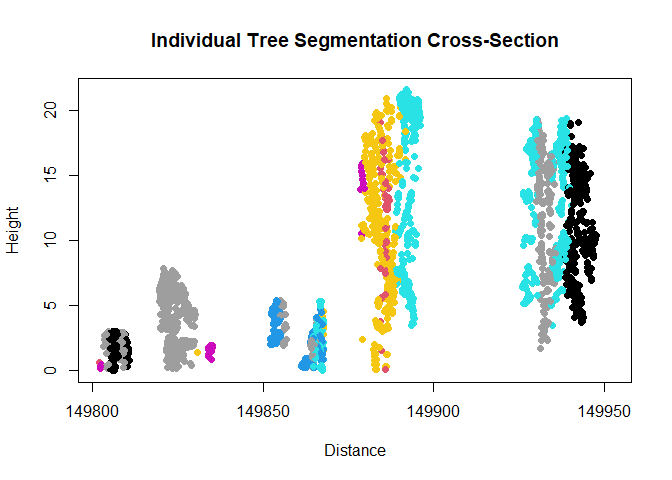

------------------------------------------------------------------------

# 6. Metrics Extraction

## 6.1 Individual Tree Level Metrics

Extract metrics for isolated tree crowns.

``` r
# Extract a single tree
tree_1 <- filter_poi(segmented_las, treeID == 1)
plot(tree_1)

# Extract maximum tree height directly
max_height <- max(tree_1$Z)
cat("Tree 1 Max Height:", max_height, "m\n")

# Standard crown metrics
crown_m <- crown_metrics(tree_1, .stdtreemetrics)
summary(crown_m)

# Standard height metrics
cloud_m <- cloud_metrics(tree_1, .stdmetrics_z)
print(cloud_m)
```

The following code computes crown volume for a single tree. See
<https://liamirwin.github.io/CompTreeR/> for instructions on calculating it
across the whole dataset.

``` r
get_crown_attributes <- function(X, Y, Z, alpha = c(Inf, 1)) {
  if (length(X) <= 3 || length(Y) <= 3 || length(Z) <= 3) {
    message("Cannot compute a 3D hull from 3 or fewer points")
    return(NULL)
  }
  
  # Prepare centered matrix for stable alpha shape computation
  mean_x <- mean(X)
  mean_y <- mean(Y)
  
  a3d_centered <- cbind(X - mean_x, Y - mean_y, Z)
  
  top_x <- X[which.max(Z)]
  top_y <- Y[which.max(Z)]
  
  # Compute alpha shape
  ashape <- alphashape3d::ashape3d(x = a3d_centered, alpha = alpha, pert = TRUE)
  
  # Calculate crown metrics
  df <- data.frame(
    Zmax = max(Z),
    Zq999 = as.numeric(quantile(Z, 0.999)),
    Zq99 = as.numeric(quantile(Z, 0.990)),
    Z_mean = mean(Z),
    n_points = length(Z),
    vol_convex = alphashape3d::volume_ashape3d(ashape, indexAlpha = 1),
    vol_concave = alphashape3d::volume_ashape3d(ashape, indexAlpha = 2),
    CV_Z = sd(Z) / mean(Z),
    CRR = (mean(Z) - min(Z)) / (max(Z) - min(Z)),
    X = top_x,
    Y = top_y
  )
  
  # Return both metrics and the fitted hull object along with shift offsets
  return(list(
    metrics = df, 
    ashape = ashape, 
    centered_points = a3d_centered
  ))
}

# Run function
result <- get_crown_attributes(
  tree_1@data[["X"]],
  tree_1@data[["Y"]],
  tree_1@data[["Z"]],
  alpha = c(Inf, 1)
)

# Extract components
metrics <- result$metrics
ashape_obj <- result$ashape
pts_centered <- result$centered_points

# --- Plot 1: Convex Hull (alpha = Inf) ---
plot(ashape_obj, indexAlpha = 1, transparency = 0.3, axes = TRUE)
rgl::points3d(pts_centered, color = "black", size = 4)

# --- Plot 2: Concave Hull (alpha = 1) ---
plot(ashape_obj, indexAlpha = 2, transparency = 0.4, axes = TRUE)
rgl::points3d(pts_centered, color = "black", size = 4)
```

## 6.2 Crown Hull Geometry Options

Computing crown geometries (polygons/hulls) using different algorithms:

``` r
# Using example dataset for multi-tree crown geometries
LASfile <- system.file("extdata", "MixedConifer.laz", package = "lidR")
trees <- readLAS(LASfile, filter = "-drop_z_below 0")

# Convex Hull
metrics_convex <- crown_metrics(trees, .stdtreemetrics, geom = "convex")

# Concave Hull
metrics_concave <- crown_metrics(trees, .stdtreemetrics, geom = "concave")

# Bounding Box
metrics_bbox <- crown_metrics(trees, .stdtreemetrics, geom = "bbox")

# Visualize concave hulls
par(mfrow=c(1,3))
plot(sf::st_geometry(metrics_concave))
plot(sf::st_geometry(metrics_convex))
plot(sf::st_geometry(metrics_bbox))
```

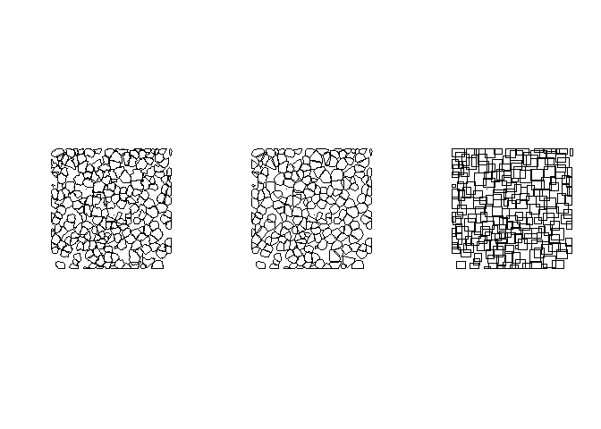

``` r
par(mfrow=c(1,1))     
```

## 6.3 Custom Metric Functions

Defining custom statistical metrics for LiDAR returns:

``` r
# Define custom height & intensity metric function
myMetrics <- function(z, i) {
  metrics <- list(
    zwimean = sum(z * i) / sum(i), # Intensity-weighted mean elevation
    zimean  = mean(z * i),         # Mean product of height and intensity
    zsqmean = sqrt(mean(z^2))      # Quadratic mean height (RMS)
  )
  return(metrics)
}

# Apply custom metrics over a stars spatial grid template
template_stars <- stars::st_as_stars(st_bbox(segmented_las), dx = 10, dy = 10)
m_custom <- template_metrics(segmented_las, myMetrics(Z, Intensity), template_stars)
plot(m_custom)
```

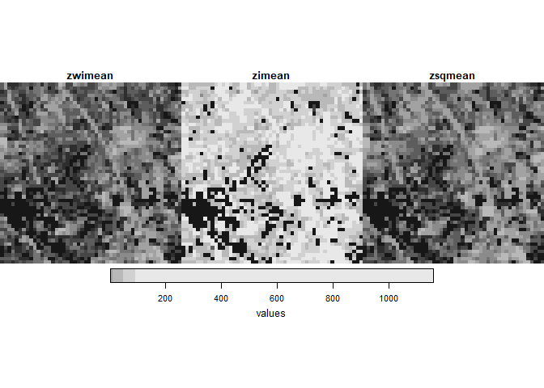

``` r
plot(chm)
```

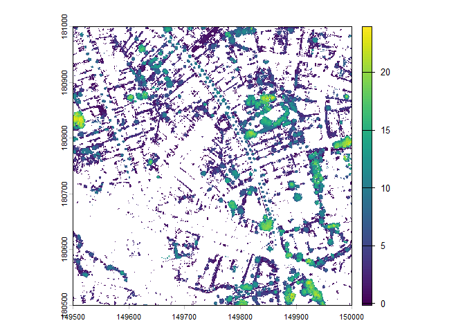

## 6.4 Pixel, Plot, and Voxel Metrics

### Pixel Metrics & Filtering Strategies

``` r
# 1. Basic approach
first_returns <- filter_poi(segmented_las, ReturnNumber == 1)
m_pixel_basic <- pixel_metrics(first_returns, ~mean(Z), res = 20)

# 2. Optimized approach (Inline filtering - memory efficient)
m_pixel_opt <- pixel_metrics(segmented_las, ~mean(Z), res = 20, filter = ~ReturnNumber == 1)

# 3. Echo-type breakdown
echo_types <- c("all", "first", "multiple")
func_echo <- ~list(avgI = mean(Intensity))
m_echo <- pixel_metrics(segmented_las, func_echo, res = 20, by_echo = echo_types)
plot(m_echo)
```

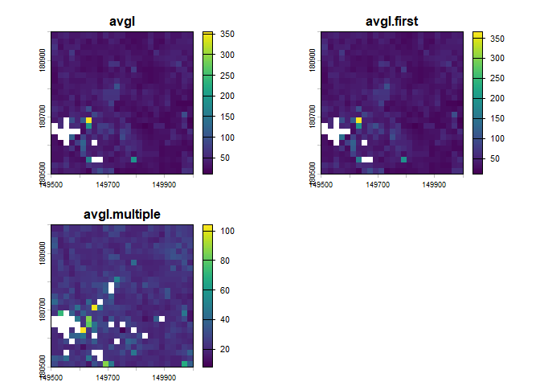

### Plot Metrics (Inventory Matching)

``` r
# Load sample forest inventory plot data
LASfile <- system.file("extdata", "Megaplot.laz", package="lidR")
las <- readLAS(LASfile, filter = "-keep_random_fraction 0.5")
plot(las)
shpfile <- system.file("extdata", "efi_plot.shp", package = "lidR")
inventory <- sf::st_read(shpfile, quiet = TRUE)
inventory # contains an ID and a Value Of Interest (VOI) per plot
plot(inventory[,1]) # Point shapefile dataset.
```

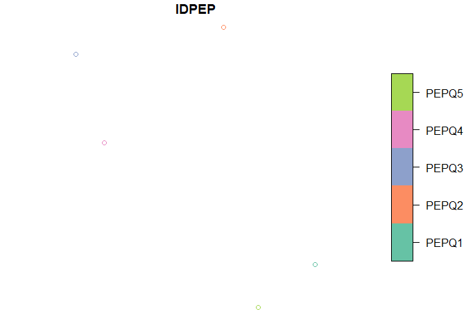

``` r
# Calculate metrics per circular plot (radius = 11.28m, ~400 m² plot)
fun_q85 <- ~list(q85 = quantile(Z, probs = 0.85))
m_plot <- plot_metrics(las, fun_q85, inventory, radius = 11.28)
plot(header(las))
plot(m_plot["q85"], pch = 19, cex = 3, add = TRUE)
```

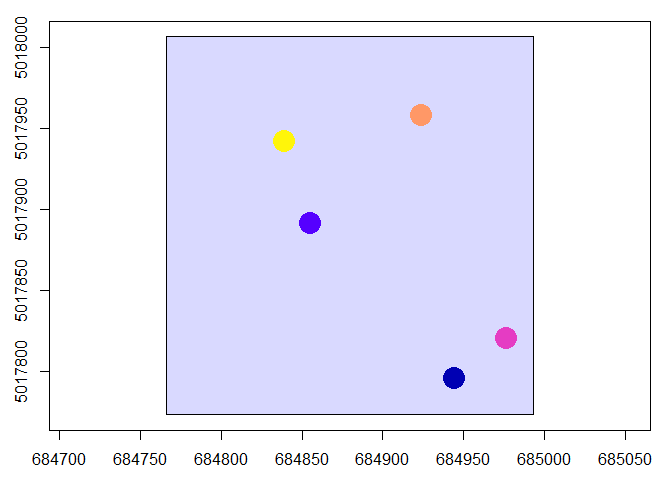

``` r
# Buffer inventory points into explicit polygon objects
inventory_poly <- sf::st_buffer(inventory, 11.28)
m_poly <- plot_metrics(las, .stdmetrics_z, inventory_poly)

# Works with polygons as well
inventory <- sf::st_buffer(inventory, 11.28)
plot(header(las))
plot(sf::st_geometry(inventory), add = TRUE)
m <- plot_metrics(las, .stdmetrics_z, inventory)
plot(m["zq85"], pch = 19, cex = 3, add = TRUE)
```

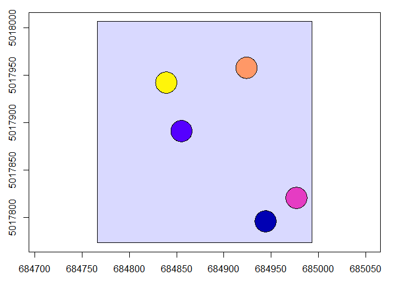

### Voxel Metrics (3D Grid Summaries)

``` r
# Generate 8m voxel counts and mean intensity
v_count <- voxel_metrics(las, length(Z), res = 8)
v_intensity <- voxel_metrics(las, mean(Intensity), res = 8)

# 3D Voxel rendering
plot(v_intensity, color = "V1", colorPalette = heat.colors(50), trim = 60, voxel = TRUE)

# 3D Voxel rendering
plot(v_count, color = "V1", colorPalette = heat.colors(50), trim = 60, voxel = TRUE)
```

------------------------------------------------------------------------

# 7. References & Further Reading

1.  **lidR Official Documentation**: Roussel et al., *lidR: Airborne
    LiDAR Data Manipulation and Visualization for Forestry
    Applications*. [CRAN lidR
    Package](https://cran.r-project.org/package=lidR)
2.  **Goodbody, T.** *lidRtutorial: Individual Tree Segmentation (ITS)*.
    [Online Tutorial &
    Code](https://tgoodbody.github.io/lidRtutorial/06_its.html)
3.  **Irwin, L.** *CompTreeR: Computational Tree Analysis in R*.
    [CompTreeR Guide](https://liamirwin.github.io/CompTreeR/)
